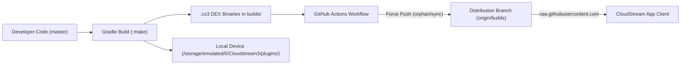

always update this agent.md file after making changes in any extension
# Development Progress & Engineering Log

## 📌 Overview
This document tracks the end-to-end debugging, feature additions, CI/CD pipeline repairs, architecture notes, and UI adjustments performed across the `cloudestrem-extension-deepu` repository, including **H2RxDMovies**, **MoviesDrive**, **AllInOneLiveTV**, and core utility providers.

---

## 🏗️ Architecture & Deployment Flow

CloudStream extensions are distributed via Git branches:
1. **`master` branch**: Source code for all providers (`TelegramProvider`, `GoogleDriveProvider`, `TorrServe`, `ExternalPlayers`, `SkipTorrentWarning`, `PopupBlocker`, `H2RxDMovies`, `AllInOneLiveTV`, `MoviesDrive`).
2. **`builds` branch**: Distribution branch containing compiled `.cs3` Dex binaries, `plugins.json`, and `repo.json`.
3. **Local Storage / Sideloading**: Direct `.cs3` files can also be copied directly to `/storage/emulated/0/Cloudstream3/plugins/` for instantaneous on-device testing.
4. **CloudStream Client**: Fetches `https://raw.githubusercontent.com/deep12323/cloudestrem-extension-deepu/builds/repo.json`, which points to `plugins.json?v=XX`.

---

## 🛠️ Issues Encountered & Solutions Implemented

### 1. Extension Missing / Not Showing in CloudStream
* **Root Cause**:
  * The `origin/builds` distribution branch had not been updated.
  * Providers were committed locally to `master`, but `.github/workflows/build.yml` did not include their `:make` tasks in the build step, and `build.yml` hardcoded the list of extensions in `plugins.json`.
* **Fix**:
  * Updated `.github/workflows/build.yml` to compile `:make` for all active providers.
  * Injected provider metadata into `plugins.json` and workflow scripts.
  * Bumped repository manifest cache busters (`?v=XX`).
  * Triggered GitHub Actions to compile and push `.cs3` packages to `origin/builds`.

---

### 2. H2RxDMovies: Catalogue Redesign & Vertical Posters
* **Requirements**:
  * Create a 25-row organized catalogue similar to Perverzija in CXXX, with vertical movie posters (2:3 aspect ratio), paginated search, and native download support.
* **Changes Made**:
  1. **Added `hasDownloadSupport = true`**: Enables direct offline video downloading.
  2. **25 Categorized Sections** in `mainPage`:
     * **Feeds**: `Home`, `Featured`, `Latest Movies`, `Latest TV Series`, `Top Rated Movies`, `Top Rated TV Series`
     * **OTT Platforms / Studios**: `Netflix`, `Amazon Prime`, `JioHotstar`, `Zee5`, `SonyLIV`, `Apple TV+`
     * **Languages**: `Hindi`, `Tamil`, `Telugu`, `Malayalam`, `English`, `Korean (K-Drama)`
     * **Genres**: `Action`, `Thriller & Crime`, `Comedy`, `Romance`, `Horror`, `Sci-Fi & Fantasy`, `Animation`
  3. **Card Aspect Ratio**: Configured `isHorizontalImages = false` and prioritized portrait posters (`poster ?: backdrop`).
  4. **Paginated Search**: Implemented `override suspend fun search(query: String, page: Int): SearchResponseList?` via `/api/v1/search?q=...&page=...`.
  5. **Version**: Bumped to **v4**.

---

### 3. MoviesDrive: Initial Implementation & Catalogue Loading (v1 & v2)
* **Problem**: MoviesDrive addon was installed but showed empty/blank content and failed to load anything.
* **Root Causes & Solutions**:
  1. **HTML Parser Mismatch**: `parsePosterCard` looked for `<a href>` inside `
`, but MoviesDrive structures cards as `<a href="...">
...
</a>`. Updated link extraction to inspect the parent tag.
  2. **Fast Search Integration**: Added Typesense fast search (`/search.php?q=...&page=...`) with fallback to WordPress REST API (`/wp-json/wp/v2/posts`) and HTML search.
  3. **Modular Settings**: Created `MoviesDrivePreferences` and `MoviesDriveSettingsFragment` allowing users to toggle and customize visible categories.

---

### 4. MoviesDrive: All Links Not Showing & Link Resolution Fixes (v3)
* **Problem**: Movie and series stream options were either missing qualities (only single resolution shown) or failed to resolve links due to timeouts.
* **Root Causes & Solutions**:
  1. **TV Series Quality Loss**: The initial scraper picked only 1 archive (`bestArchive` in 720p) per season, discarding 480p, 1080p, and 4K archives. Updated `load()` to concurrently fetch all quality archives per season in parallel and merge all download options into each episode.
  2. **HubCloud Crawler Hang**: A broad regex matched `hubcloud.pw/drive/admin`, triggering 10s blocking requests on non-existent endpoints and timing out CloudStream's link dialog. Restricted pattern to `(?:pixel|gpdl)\.hubcloud` and `?id=`.
  3. **Stream Labeling**: Stream link names now display full server details, quality, codec, and size (e.g. `HubCloud FSL • 1080p MULTI H.264 [8.96 GB]`, `HubCloud 10Gbps • 4k 2160p MULTI SDR [22.9GB]`), preventing CloudStream from collapsing distinct streams.

---

### 5. MoviesDrive: Stream Link Sorting by Decreasing File Size (v4)
* **Problem**: Stream links were emitted non-deterministically based on network arrival times, resulting in small or random quality links appearing before large high-bitrate files.
* **Root Causes & Solutions**:
  1. **Byte-Accurate Size Parsing**: Created `MoviesDriveHubCloud.parseSizeToBytes(str, fallbackQuality)` supporting `TB`, `GB`, `MB`, `KB`, `B` (including `GiB` and `MiB`) to convert strings like `22.9GB`, `8.96 GB`, `639.45 MB`, `550MB/E` into exact `Long` byte counts.
  2. **HubCloud Page Size Scraping**: Enhanced `resolveHubCloud` to extract `<i id="size">` directly from HubCloud HTML if not already parsed from the archive title.
  3. **Multi-Level Descending Comparator**: In `loadLinks`, all extracted stream links are collected, deduplicated by stream URL, and sorted with:
     * **Primary**: Exact file size in bytes (`compareByDescending { it.sizeBytes }`).
     * **Secondary**: Video quality resolution (`thenByDescending { it.link.quality }`).
     * **Tertiary**: Server priority (`thenByDescending { it.serverPriority }`: FSL Direct R2 [4] > 10Gbps Google CDN [3] > Fast Stream [2] > PixelDrain [1]).
  4. **Episode & Movie Payload Sorting**: Sorted download options within `load()` so TV episode headings list qualities in descending order (e.g., `Episode 1 (4k, 1080p, 720p, 480p)`).
  5. **Direct Sideloading**: Output compiled binary directly to `/storage/emulated/0/Cloudstream3/plugins/MoviesDrive.cs3` and pushed to GitHub.

---

## 📑 Full Catalogue Breakdown in H2RxDMovies (v4)

| Category Name | API Query Endpoint | Card Format |
|---|---|---|
| **Home** | `/api/v1/catalog?sort=lastmod` | Vertical Poster |
| **Featured** | `/api/v1/catalog?sort=downloads` | Vertical Poster |
| **Latest Movies** | `/api/v1/movies?sort=lastmod` | Vertical Poster |
| **Latest TV Series** | `/api/v1/series?sort=lastmod` | Vertical Poster |
| **Top Rated Movies** | `/api/v1/movies?sort=rating` | Vertical Poster |
| **Top Rated Series** | `/api/v1/series?sort=rating` | Vertical Poster |
| **Netflix** | `/api/v1/catalog?source=Netflix` | Vertical Poster |
| **Amazon Prime** | `/api/v1/catalog?source=Amazon` | Vertical Poster |
| **JioHotstar** | `/api/v1/catalog?source=JioHotstar` | Vertical Poster |
| **Zee5** | `/api/v1/catalog?source=Zee5` | Vertical Poster |
| **SonyLIV** | `/api/v1/catalog?source=SonyLiv` | Vertical Poster |
| **Apple TV+** | `/api/v1/catalog?source=AppleTVPlus` | Vertical Poster |
| **Hindi** | `/api/v1/catalog?audio=Hindi` | Vertical Poster |
| **Tamil** | `/api/v1/catalog?audio=Tamil` | Vertical Poster |
| **Telugu** | `/api/v1/catalog?audio=Telugu` | Vertical Poster |
| **Malayalam** | `/api/v1/catalog?audio=Malayalam` | Vertical Poster |
| **English** | `/api/v1/catalog?audio=English` | Vertical Poster |
| **Korean (K-Drama)** | `/api/v1/catalog?audio=Korean` | Vertical Poster |
| **Action** | `/api/v1/catalog?genre=Action` | Vertical Poster |
| **Thriller & Crime** | `/api/v1/catalog?genre=Thriller` | Vertical Poster |
| **Comedy** | `/api/v1/catalog?genre=Comedy` | Vertical Poster |
| **Romance** | `/api/v1/catalog?genre=Romance` | Vertical Poster |
| **Horror** | `/api/v1/catalog?genre=Horror` | Vertical Poster |
| **Sci-Fi & Fantasy** | `/api/v1/catalog?genre=Science+Fiction` | Vertical Poster |
| **Animation** | `/api/v1/catalog?genre=Animation` | Vertical Poster |

---

## 📦 Verified Active Plugins in Repository

| Plugin Name | Internal ID | Version | Description |
|---|---|---|---|
| **Telegram** | `TelegramProvider` | `167` | On-demand streaming from Telegram chats and forum topics |
| **Google Drive** | `GoogleDriveProvider` | `12` | Stream media from personal and shared Google Drives |
| **TorrServe** | `TorrServe` | `6` | BitTorrent engine with 40+ Tier-1 trackers & memory tuner |
| **External Players** | `ExternalPlayers` | `1` | MPV Infinity & 1DM integrations in video player selector |
| **Skip Torrent Warning**| `SkipTorrentWarning` | `3` | Bypasses torrent confirmation dialog & displays live stats |
| **Popup Blocker** | `PopupBlocker` | `1` | Suppresses donation popups & modal sponsor dialogs |
| **H2RxDMovies** | `H2RxDMovies` | **`4`** | 25-row catalogue streaming movies & TV series via HubCloud |
| **Allinone Live TV** | `AllInOneLiveTV` | **`1`** | Live TV & Sports channels (JioTV Plus, SonyLiv, Sports TV, Fancode) |
| **MoviesDrive** | `MoviesDrive` | **`4`** | Movies & TV series with HubCloud extraction sorted by decreasing file size |

---

## 🔄 How to Release Future Updates
Whenever updating provider code:
1. Bump `version = X` in `<Provider>/build.gradle.kts`.
2. Update the provider entry in `builds/plugins.json` and `.github/workflows/build.yml` (`?v=X` and `"version": X`).
3. Bump `repo.json` cache buster (`?v=YY`) in `builds/repo.json` and `.github/workflows/build.yml`.
4. Run `./gradlew :<Provider>:make` to generate the `.cs3` artifact in `builds/`.
5. If testing locally on device, copy `builds/<Provider>.cs3` to `/storage/emulated/0/Cloudstream3/plugins/<Provider>.cs3`.
6. Commit and push to `master`. GitHub Actions will automatically compile, package, and force-push to `origin/builds`.
