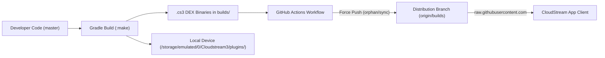

always update this agent.md file after making changes in any extension
# Development Progress & Engineering Log

## 📌 Overview
This repository contains the cloud storage & personal media CloudStream extensions:
- **TelegramProvider**: On-demand streaming from Telegram channels, forum topics, ZIP streams, and multi-part split file merging. Includes the **Teleflix** Cinemeta feed provider.
- **GoogleDriveProvider**: Direct streaming from personal and shared Google Drives with recursive scanning and thumbnail extraction.

> [!NOTE]
> All other providers and utility extensions (TorrServe, ExternalPlayers, SkipTorrentWarning, PopupBlocker, H2RxDMovies, AllInOneLiveTV, MoviesDrive, NextUp) have been moved to:
> 👉 **[deep12323/cloudstream-plugins](https://github.com/deep12323/cloudstream-plugins)**

---

## 🏗️ Architecture & Deployment Flow

CloudStream extensions are distributed via Git branches:
1. **`master` branch**: Source code for `TelegramProvider` and `GoogleDriveProvider`.
2. **`builds` branch**: Distribution branch containing compiled `.cs3` Dex binaries, `plugins.json`, and `repo.json`.
3. **Local Storage / Sideloading**: Direct `.cs3` files can also be copied directly to `/storage/emulated/0/Cloudstream3/plugins/` for instantaneous on-device testing.
4. **CloudStream Client**: Fetches `https://raw.githubusercontent.com/deep12323/cloudestrem-extension-deepu/builds/repo.json`, which points to `plugins.json?v=XX`.

---

## 📦 Active Plugins in this Repository

| Plugin Name | Internal ID | Version | Description |
|---|---|---|---|
| **Telegram** | `TelegramProvider` | `167` | On-demand streaming from Telegram chats and forum topics |
| **Google Drive** | `GoogleDriveProvider` | `12` | Stream media from personal and shared Google Drives |

---

## 🔄 How to Release Future Updates
Whenever updating provider code:
1. Bump `version = X` in `<Provider>/build.gradle.kts`.
2. Update the corresponding `version: X` and URL version query in `.github/workflows/build.yml`.
3. Push to `master`. GitHub Actions will automatically compile `.cs3` files and deploy them to the `builds` branch.
